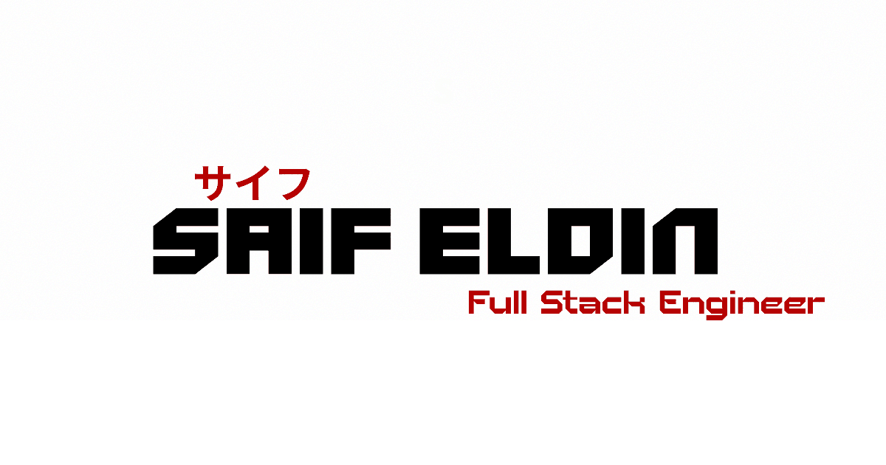

<p align="center">
  
</p>

<p align="center">
  <b>Saif Eldin Ayman</b> — Full-stack engineer<br/>
  React, Django, PostgreSQL, real-time systems. No filler.
</p>

<p align="center">
  <a href="https://saifayman23.github.io/portfolio/v2/"></a>
  <a href="https://github.com/SaifAyman23/portfolio-v2/actions"></a>
  
  
  
  
  
</p>

<p align="center">
  
</p>

<p align="center">
  <code>react</code> <code>typescript</code> <code>vite</code> <code>tailwind</code> <code>gsap</code> <code>three</code> <code>lenis</code> <code>radix-ui</code> <code>vitest</code>
</p>

## // What this is

Portfolio for Saif Eldin Ayman — the code is the first impression. Dark, atmospheric, over-engineered on purpose.

- **Hero** — WebGL `PixelBlast` backdrop (guarded, DPR-capped), staggered intro, R3F jet flyby on `xl`+
- **About / Experience** — pinned scrub on desktop, scrub-no-pin on small screens, split-char type-ins
- **Projects** — pinned showcase: outline title, cover crossfades, scroll-driven project switching
- **Tools** — radar sweep, tick ring, live meters (paused off-screen), skill switcher
- **Contact / Footer** — chamfered cyber shapes, footer reveal, expandable widget

Live: **https://saifayman23.github.io/portfolio/v2/**

## // Stack

| Layer     | Tech                                                  |
| --------- | ----------------------------------------------------- |
| Framework | **React 19** + **TypeScript (strict)**                |
| Bundler   | **Vite 7** — HMR, `manualChunks`                      |
| Styling   | **Tailwind CSS v4** + CSS variable tokens             |
| UI        | **Radix UI** + custom cyber primitives + **Lucide**   |
| Motion    | **GSAP** + **Lenis** — `transform` and `opacity` only |
| Shaders   | **three.js** / **R3F** (`PixelBlast`, jet)            |
| Testing   | **Vitest + RTL + axe-core**                           |

## // Quick start

```bash
git clone https://github.com/SaifAyman23/portfolio-v2.git
cd portfolio-v2
npm install
npm run dev            # http://localhost:5173
```

> Node 20+ / npm 10+

## // Scripts

| Command             | What it does                                    |
| ------------------- | ----------------------------------------------- |
| `npm run dev`       | Dev + HMR                                       |
| `npm run build`     | `tsc -b && vite build` to `dist/`               |
| `npm run preview`   | Preview `dist/`                                 |
| `npm run check`     | `typecheck, lint, format:check, test`           |
| `npm run typecheck` | `tsc -b --noEmit`                               |
| `npm run lint`      | ESLint flat                                     |
| `npm run format`    | Prettier write                                  |
| `npm run test`      | Vitest + axe                                    |
| `npm run img:webp`  | Convert images to WebP (`scripts/img2webp.mjs`) |
| `npm run deploy`    | Build + publish `dist/` to the token path       |

## // Structure

```
src/
├── components/
│   ├── sections/       # Hero, About, Experience, Projects, Tools, Contact, Footer
│   ├── jet/            # R3F jet scene (xl only, WebGL-guarded)
│   ├── ui/             # CyberFrame, CyberImage, JapaneseText, Tag, primitives
│   └── PixelBlast.tsx  # WebGL backdrop
├── hooks/              # useMediaQuery, useNearView, useSectionTracker
├── lib/                # seo, motion, smoothScroll, webgl, scroll-refresh, utils
├── pages/              # Home (thin orchestrator)
└── test/               # Vitest + axe
```

Full conventions in [`AGENTS.md`](./AGENTS.md). Playbooks in [`docs/`](./docs).

## // Perf and SEO

- WebP everywhere (`npm run img:webp`), explicit frame sizes, `loading="lazy"` below fold
- Fonts non-blocking with `font-display: swap`, skeleton until React mounts
- `manualChunks` splits, heavy 3D behind WebGL guards + off-screen pauses
- `robots.txt` + `sitemap.xml` via Vite plugin, `SeoUpdater` per route

## // Env

All optional, typed in `src/vite-env.d.ts`:

```
VITE_API_URL=https://api.example.com/api/v1
VITE_APP_NAME=Portfolio
VITE_SITE_URL=https://saifayman23.github.io/portfolio/v2
```

## // Deploy

`npm run deploy` builds and pushes `dist/` to the token path via `gh-pages --dest`. The frame shells (`/v2/`, `/v0/`) assemble in the sibling `portfolio` repo and publish with `gh-pages --add` so hashed assets are never pruned.

SPA: rewrite all paths to `index.html`.
